# Folder Size Aurora

Analizador de espacio en disco para Windows, escrito en **.NET 10 (WPF)**. Mide carpetas y
unidades con un árbol que se lee de un vistazo y, sobre todo, **vigila tus límites**: ponle un
tope a una carpeta o a una unidad entera y te avisa por varios canales antes de quedarte sin
espacio.

Sin cuenta, sin nube, sin suscripción y sin enviar un solo byte de tus archivos a ninguna parte.

---

## Qué hace

### Explorador de carpetas
- Escaneo recursivo de cualquier carpeta o unidad, con **progreso en vivo** y cancelación.
- **Modo pre-scan**: las filas van apareciendo mientras el análisis avanza, con los hijos directos
  ya conocidos. No hay que esperar al final para ver por dónde va.
- Árbol con carpetas **y** archivos intercalados por tamaño, con columna de tamaño, porcentaje,
  barra de uso y contenido (`archivos / carpetas`).
- Panel de detalle con la ficha completa de lo seleccionado, y ruta completa como tooltip.
- Recorrido **iterativo con pila**: no se desborda la pila en árboles muy profundos.
- Salta junctions, symlinks y puntos de repetición, de modo que los ciclos no cuelgan el escaneo.
- Tolera carpetas sin permisos: las cuenta como "omitidas" y sigue.

### Modo capa (navegar sin re-escanear)
**Doble clic en una carpeta** para entrar en ella. El árbol completo ya está en memoria, así que
entrar es cambiar de vista, no repetir el análisis: instantáneo aunque la unidad tenga millones
de archivos.

- Una barra de ruta aparece sobre el listado con la ruta por la que has entrado.
- El botón **↑** (o el de la barra) vuelve al nivel anterior.
- Todo lo demás —filtros, orden, búsqueda— sigue funcionando dentro de la carpeta.

### Unidades
- Lista de todas las unidades con espacio usado, libre y total, y barra de ocupación que
  cambia de color según el margen (azul normal, ámbar al llenarse, rojo al crítico).
- **Doble clic** en una unidad analiza la unidad completa desde la raíz.
- El carril se puede plegar a una tira de 44 px con solo los iconos (`Ctrl+B`).

### Filtros y orden (sin volver a escanear)
- **Tamaño mínimo**: sin mínimo, 1 KB, 100 KB, 1 MB, 10 MB, 100 MB, 1 GB.
- **Tipo de archivo**: todos, imágenes, vídeo, audio, documentos, comprimidos, código,
  imágenes de disco, ejecutables.
- **Orden**: tamaño, nombre, cantidad de archivos, última modificación (ascendente/descendente).
  También se ordena **pulsando la cabecera** de la columna.
- **Búsqueda** por nombre de archivo o carpeta en todo el árbol, agrupada a 220 ms para que
  teclear rápido no congele la ventana.
- Incluir/excluir archivos ocultos y de sistema.

Los filtros se aplican sobre clones del resultado original, así que el escaneo se conserva
intacto y se puede volver a la vista completa en cualquier momento.

### Gráficos
- Top 10 de carpetas más pesadas.
- Top 10 de archivos más pesados.
- Reparto por tipo de archivo.
- Barras proporcionales al total, con paleta coherente y tooltips con la ruta completa.
- **Clic derecho** en cualquier barra: abrir la carpeta o copiar su ruta.

### Exportación
- **CSV** con BOM UTF-8 (se abre bien en Excel con acentos), una fila por carpeta y por archivo.
- **JSON** con el árbol completo y metadatos.
- **Informe de texto** con los 15 mayores y un resumen.

### Historial de escaneos (SQLite)
Cada análisis se guarda en una base SQLite local (`%LOCALAPPDATA%\FolderSizeAurora\scans.db`).
En la pestaña **Vigilancia** hay un panel con todos los escaneos guardados:

- **Cargar**: reabre un escaneo anterior **sin volver a analizar**, con todo su árbol.
- **Comparar**: contrasta el escaneo actual con uno anterior y muestra la diferencia de tamaño
  total y por carpeta (crecido, encogido, nuevo, desaparecido).

### Monitoreo de límites  ← la diferencia
- Reglas sobre **carpetas** (límite en bytes) y **unidades** (límite en porcentaje).
- Comprobación periódica configurable (cada minuto a cada día), con botón **Comprobar ahora**.
- Barra de uso por regla, en azul mientras está en rango y en rojo al superarse, con el estado
  escrito al lado para no depender solo del color.
- **Enfriamiento de 30 minutos**: una alerta repetida no vuelve a notificarse.
- **Silenciar** una regla concreta desde la notificación: 1 hora o 24 horas.
- Las reglas se guardan y se restauran al abrir la aplicación.

### Avisos por varios canales
| Canal | Qué hace |
|---|---|
| Toast nativo de Windows | Notificación del sistema con botones: **Abrir carpeta**, **Silenciar 1h**, **Silenciar 24h** |
| En la aplicación | Aviso flotante en la esquina + historial de alertas |
| Sonido | `SystemSounds.Hand` |
| Correo | SMTP con TLS opcional, remitente y destinatario configurables |
| Webhook | `POST` JSON a una URL (Slack, Teams, n8n, Home Assistant, script propio…) |
| Registro local | Siempre a `%LOCALAPPDATA%\FolderSizeAurora\alertas.log` |

Cada canal es independiente: si el correo falla, el resto se entrega igual, y la sección
**Entregas** de la pestaña Vigilancia muestra el resultado (`OK` / `Fallo`) de cada intento.
Hay botón de **notificación de prueba** para validar la configuración.

El toast nativo necesita un **protocolo propio** (`foldersizeaurora://`) registrado en Windows:
la app lo registra sola al arrancar, y el instalador lo escribe para que funcione desde el
primer minuto.

### Interfaz
Diseñada para leerse de un vistazo, no para impresionar:

- **Tema claro y oscuro** con conmutación instantánea (sin reiniciar), claro por defecto.
- **Listado plano** (`ListView` con columnas reales) en lugar de un árbol con cabecera imitada:
  las cabeceras no pueden desfasarse de las filas porque comparten las medidas de columna.
- La cabecera se ajusta sola al ancho real del área visible, así que las cifras caen siempre
  debajo de su columna aunque aparezca o desaparezca la barra de desplazamiento.
- **Iconos dibujados** en un único trazo de 1,3 px: ningún glifo Unicode haciendo de icono.
- Tipografía a dos voces: `Segoe UI` para leer, `Consolas` con cifras tabulares para todo número.
- Barras de proporción dentro de cada fila: dan la magnitud sin sumar una columna de números.
- Estados vacíos que explican **qué hacer**, no solo que no hay nada.
- Aviso flotante al superar un límite, descartable, que no tapa los datos.
- Deslizadores de perfil estrecho y discretos, incluidos los que WPF crea internamente.
- La ventana admite de 1024 px de ancho en adelante: el riel de filtros está dimensionado para
  caber en ese mínimo sin recortarse.
- **La ventana se coloca contra el área de trabajo real del monitor, no contra la pantalla.**
  Abre a 1320×800 si cabe; si no cabe —1366×768 con barra de tareas, o cualquier pantalla con
  escalado DPI por encima del 100 %— se recorta hasta el área útil y se centra dentro de ella.
  Los mínimos también bajan con ella, porque WPF no deja encoger una ventana por debajo de
  `MinWidth`: un mínimo de 1024 fijo volvería a empujar la ventana fuera de la pantalla.

#### Modos de ventana
| Modo | Para qué | Cómo se activa |
|---|---|---|
| Normal | Todo visible | — |
| Always on top | Dejar el análisis flotando encima de otras ventanas | Botón del pin, `Ctrl+T` |
| Presentación | Pantalla completa sin bordes, sin barra de tareas | Botón de presentación, `F11` |
| Compacto | Filas más densas, cabe más información en pantalla | Botón de filas compactas |
| Kiosko | Pantalla completa sin chrome, para dejar el análisis en una pantalla fija | `Ctrl+Shift+K` (para salir) |

#### Atajos
`Ctrl+O` elegir carpeta · `Ctrl+R` repetir análisis · `Ctrl+B` plegar el carril ·
`Ctrl+D` cambiar de tema · `Ctrl+E` desplegar todo · `Ctrl+L` recoger todo ·
`Ctrl+T` ventana siempre encima · `F11` presentación · `Ctrl+Shift+K` kiosko

### Menú contextual de la fila

Clic derecho sobre cualquier fila del árbol. Lo que no aplica a una carpeta se esconde, y los
separadores se ocultan con ellas para que no queden dos seguidos:

| Acción | Carpeta | Archivo | Qué hace |
|---|:--:|:--:|---|
| Abrir en el Explorador de archivos | ✅ | | Abre la carpeta en el explorador del sistema |
| Abrir el archivo | | ✅ | Lo abre con el programa asociado |
| Mostrar en el Explorador de archivos | | ✅ | Abre el explorador con el archivo seleccionado |
| Abrir en PowerShell | ✅ | ✅ | Consola en esa carpeta (PowerShell 7 si está, si no el 5) |
| Analizar solo esta carpeta | ✅ | | Vuelve a analizar desde ahí, sin el resto de la unidad |
| Vigilar esta carpeta | ✅ | | Crea la regla de límite en la pestaña Vigilancia |
| Copiar ruta | ✅ | ✅ | Al portapapeles, con reintentos si está ocupado |

Si algo falla al abrirse (por ejemplo, no hay PowerShell), el pie lo dice en vez de dejar la
aplicación en silencio.

### Bandeja del sistema, arranque y actualizaciones
- **Minimizar a la bandeja**: al minimizar, la ventana se esconde y sigue trabajando. El icono
  tiene menú con *Mostrar* y *Salir*, y doble clic restaura la ventana.
- **Iniciar con Windows**: añade una entrada en `HKCU\...\CurrentVersion\Run`.
- **Buscar actualizaciones al arrancar**: consulta en silencio la última release de GitHub y
  avisa en el pie si hay una más nueva. No bloquea el arranque y falla en silencio si no hay red.
- **Badge en la barra de tareas**: el icono muestra el número de alertas sin leer.

Los tres se activan o desactivan desde la pestaña **Vigilancia**, en el panel *Aplicación*.

### Línea de comandos
La misma aplicación es un CLI. Si se le pasa un argumento, entra en modo headless y no abre
ventana:

```powershell
FolderSizeAurora scan "C:\data" --csv salida.csv
FolderSizeAurora scan "C:\data" --json salida.json
FolderSizeAurora scan "C:\data" --report informe.txt
```

Se pueden combinar varios formatos en la misma llamada. Imprime por consola el total de
archivos, carpetas y tamaño antes de exportar.

---

## Por qué no se cuelga

«Se queda freezeada» casi nunca significa que falte un `await`: significa que **el hilo de la
interfaz está ocupado**. Con el árbol vacío todo iba bien; al analizar algo grande, la ventana
dejaba de repintar. Había tres trabajos sin límite, y los tres crecían con el número de archivos:

- **El recorrido del disco** se hacía en el hilo de la interfaz. Ahora el escaneo entero corre
  fuera y el progreso sigue llegando a la ventana.
- **Filtrar y ordenar** clona y ordena cientos de miles de nodos. Eso también corre fuera; a la
  interfaz solo se le publica el resultado ya construido. Un contador de generations descarta el
  resultado si mientras se calculaba cambió un filtro, así que escribir rápido no cruza vistas.
- **El gráfico de archivos mayores** ordenaba *todos* los archivos de la unidad para quedarse con
  diez. Ahora solo conserva los diez mejores. Y ordenar por «Última modificación» era **cuadrático**;
  se resuelve en una sola pasada.
- **Desplegar una unidad** era el peor caso de todos, por dos razones que no se ven leyendo el
  XAML: la columna de modificación recalculaba `Files.Max(...)` **en cada repintado de cada fila**
  (recorrer todos los archivos de la carpeta, otra vez, por fila), y las filas se insertaban una a
  una, lanzando un aviso de colección por fila. Ahora la fecha se acumula durante el escaneo y el
  listado se rellena con un único aviso.
- Además, el listado dibuja como máximo **5 000 filas** y solo abre **40 ramas** de primer nivel al
  terminar un análisis. Si se supera el tope, el pie lo dice con cifras en lugar de recortar en
  silencio.

Medido con una sonda que cronometra cuánto tarda la interfaz en responder:

| Qué | Peor bloque antes | Peor bloque ahora |
|---|---|---|
| Escanear 26 571 archivos | 25 ms | 16 ms |
| Escanear 154 834 archivos | **234 ms** | **30 ms** |
| Desplegar todo un árbol | miles de filas, fila a fila | **29 ms** |

Lo importante es que **dejó de crecer con el tamaño del árbol**.

Comprobado además sobre la unidad real de trabajo: `Z:\` (293 GB, **926 909 archivos y 344 617
carpetas**) se analiza en ~27 s, ocupa 801 MB y **la ventana responde en todo momento**, con el
árbol desplegado.

---

## Capturas

Las once imágenes de esta sección están **renderizadas por el arnés** desde la ventana real,
no son maquetas (las dos del menú, como se indica, están capturadas del escritorio).

**Explorador, tema claro**

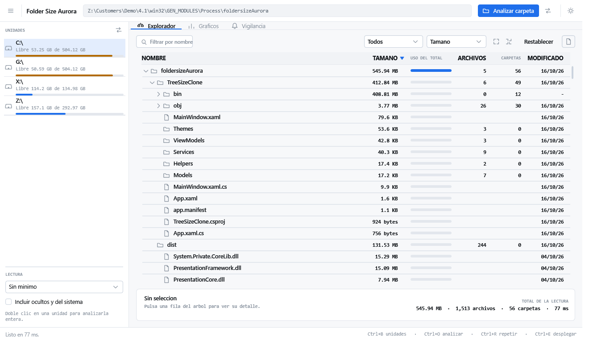

**Explorador, tema oscuro**

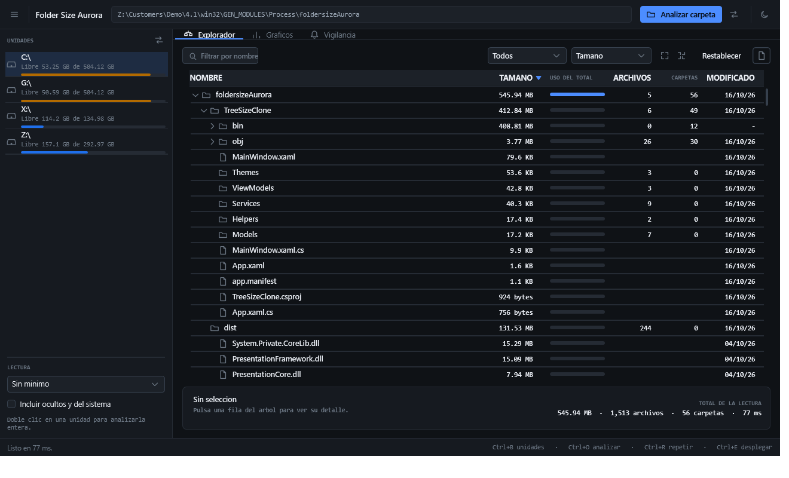

**Gráficos**

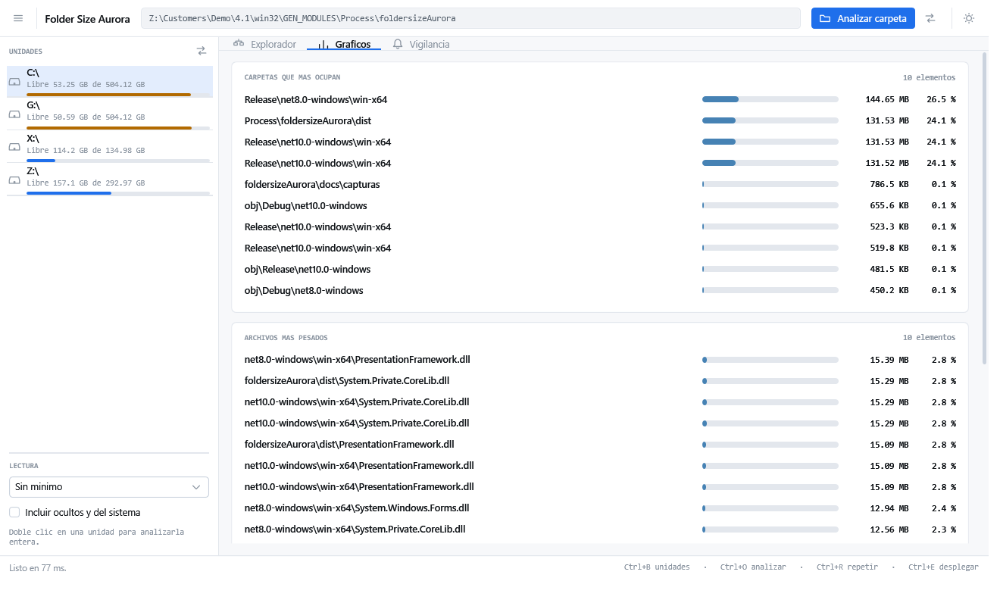

**Vigilancia**

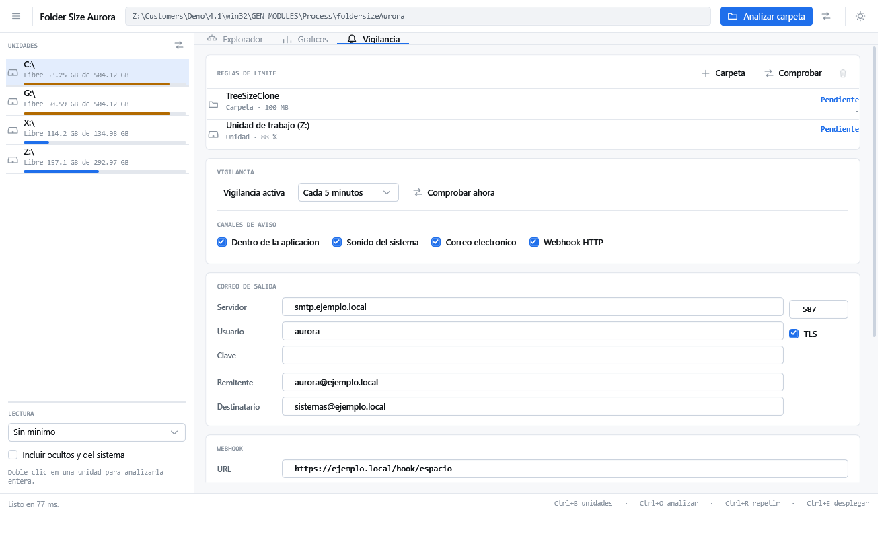

**Ancho mínimo de la ventana (1024 px): nada se sale ni se recorta**

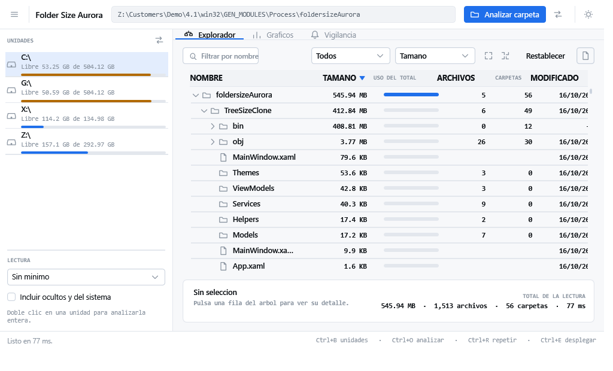

**Área de trabajo típica de un portátil a 125 % (1280×720): la ventana se ajusta y se centra**

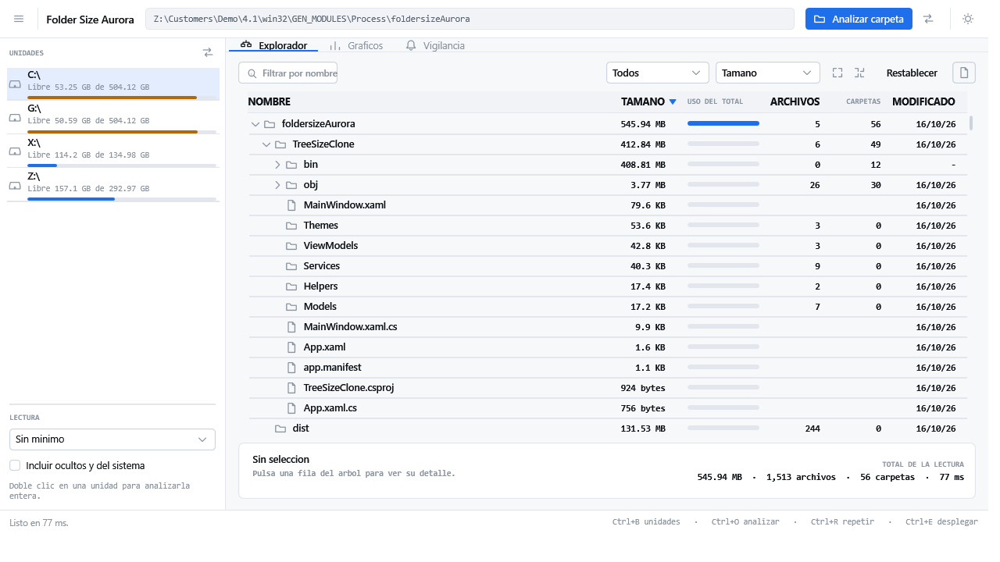

**Carril de unidades plegado**

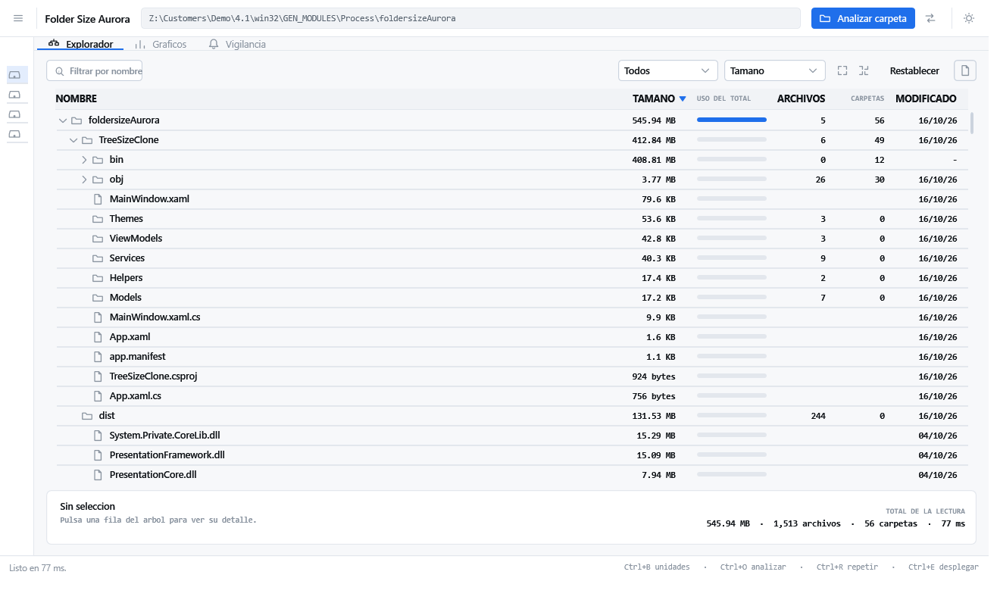

**Aviso flotante al superar un límite**

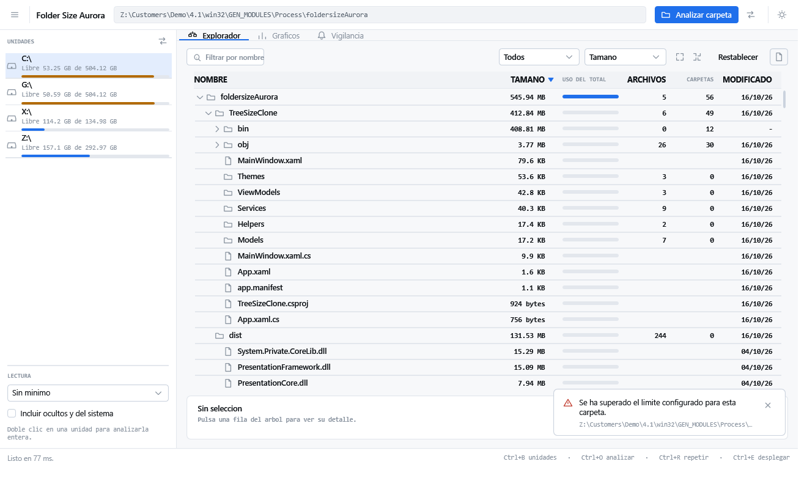

**Ventana de 900×600, por debajo del mínimo de comfort: la barra superior y el pie siguen en su sitio**

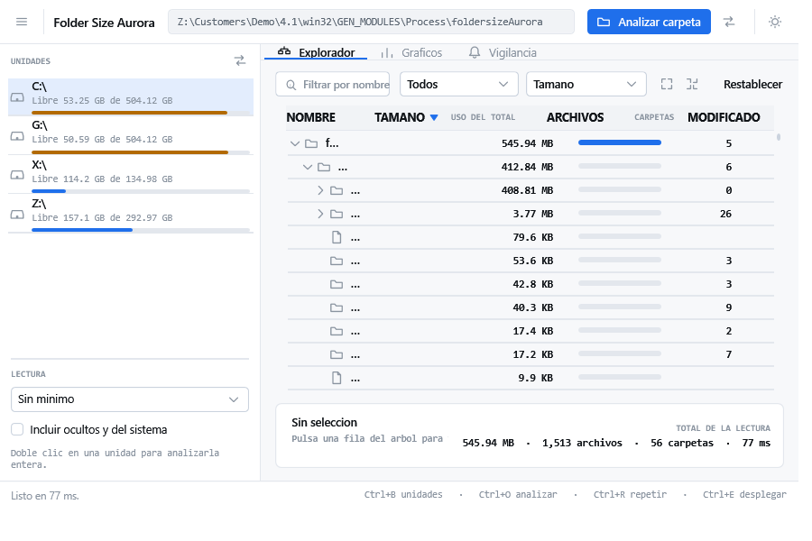

**Menú contextual sobre una carpeta**

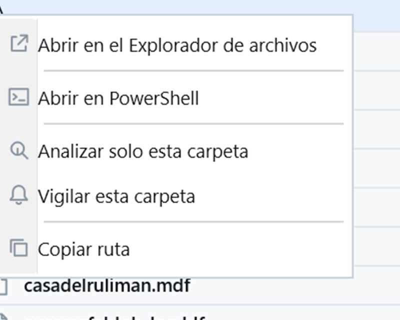

**El mismo menú sobre un archivo: solo las acciones que aplican**

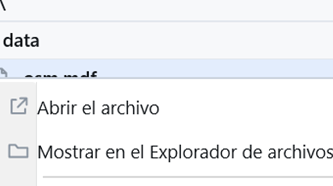

> Las dos últimas son capturas de la aplicación real en su escritorio, no del arnés: un menú
> contextual vive en una ventana emergente y el renderizador del arnés no la alcanza.

---

## Instalación

Hay dos instaladores MSI, construidos desde el mismo archivo editable:

| MSI | Alcance | Requiere admin |
|---|---|:--:|
| `FolderSizeAurora.msi` | Por máquina → `Program Files` | Sí |
| `FolderSizeAurora-user.msi` | Por usuario → `%LOCALAPPDATA%` | No |

```powershell
msiexec /i installer\FolderSizeAurora-user.msi     # sin privilegios
msiexec /i installer\FolderSizeAurora.msi          # requiere Administrador
msiexec /i installer\FolderSizeAurora-user.msi /qn # silencioso
```

También hay un **ejecutable autocontenido** de 142 MB que no necesita instalar nada:
`landing\FolderSizeAurora.exe`.

### El instalador (editable)

El instalador MSI se construye desde **`installer/FolderSizeAurora.wxs`**, un archivo de **WiX
Toolset** totalmente editable: todo el comportamiento del instalador está ahí dentro.

```powershell
# Publica la app autocontenida, genera el icono y compila los dos MSI
powershell -ExecutionPolicy Bypass -File installer\Build-Installer.ps1
```

| Archivo | Qué es |
|---|---|
| `installer\FolderSizeAurora.wxs` | **Fuente del instalador.** Se edita a mano |
| `installer\Build-Installer.ps1` | Publica + compila (script de una orden) |
| `installer\FolderSizeAurora.ico` | Icono multirresolución, generado desde `logo-256.png` |
| `tools\Make-Ico.ps1` | Regenera el `.ico` cuando cambia el logo |

Qué incluye el asistente:

- **Carpeta de instalación elegible** (`WixUI_InstallDir`).
- **Accesos directos**: Menú Inicio (por defecto), Escritorio e *Iniciar con Windows* (opcionales,
  se activan desde el asistente).
- **Protocolo `foldersizeaurora://`** registrado en el sistema, para que las notificaciones con
  acciones funcionen sin abrir la app primero.
- **Actualización** entre versiones: el `UpgradeCode` es fijo y el `ProductCode` cambia por release.
- Entrada completa en **Agregar y quitar programas**, con icono y desinstalación.

#### Cómo editarlo

Todo se cambia en el `.wxs` y se recompila:

| Quiero… | Cambio en el `.wxs` |
|---|---|
| Cambiar la versión | `Version="$(var.Version)"` se pasa por `-d Version=1.2.0` |
| Cambiar la carpeta | `Name="Folder Size Aurora"` dentro de `Directory` |
| Añadir un acceso directo | Copia un `<Component>` con `<Shortcut>` y su `<Feature>` |
| Cambiar el protocolo | `Software\Classes\foldersizeaurora` en `ProtocolHandler` |
| Cambiar el icono | `Icon Id="FolderSizeAuroraIcon" SourceFile="..."` |

Los parámetros de compilación (`Scope`, `RootDir`, `RegistryRoot`, `InstallFolderId`) son variables
del preprocesador de WiX, así que el mismo `.wxs` genera las dos variantes sin duplicarse.

> **Cuidado con los GUID**: `UpgradeCode` identifica la *familia* de producto y **no** debe
> cambiar entre versiones (es lo que permite actualizar). `ProductCode` identifica *esta* versión
> y sí es distinto en cada release.

---

## Compilarlo desde Visual Studio

1. Doble clic en **`foldersizeaurora.sln`**.
2. Menú **Build → Restore NuGet Packages** (o `Ctrl+Shift+Q`).
3. Menú **Build → Build Solution** (`Ctrl+Shift+B`).
4. Menú **Debug → Start Debugging** (`F5`) para ejecutar.

Requisitos: **Visual Studio 2026 (18.x)** con la carga de trabajo **".NET desktop development"**
(SDK .NET 10). No hay ningún paquete NuGet externo que instalar.

Desde consola:

```powershell
cd .\foldersizeaurora
dotnet restore
dotnet build
dotnet run
```

Y para generar el ejecutable:

```powershell
# Carpeta normal (necesita el runtime .NET 10 Desktop instalado)
dotnet publish .\foldersizeaurora\FolderSizeAurora.csproj -c Release -o .\dist

# Autocontenido: NO necesita instalar nada, se lleva el runtime dentro (≈142 MB)
dotnet publish .\foldersizeaurora\FolderSizeAurora.csproj -c Release -r win-x64 --self-contained true -o .\dist-standalone
```

**Si te aparece `NETSDK1004` ("Assets file not found")**: es que falta el restore. Ejecuta
`dotnet restore` una vez, o en Visual Studio usa **Build → Restore NuGet Packages**.

**Si te aparece que falta el tipo de proyecto**: asegúrate de tener instalada la carga
".NET desktop development"; es la que aporta el soporte de WPF.

### Nota sobre versiones de .NET

El proyecto apunta a **`net10.0-windows10.0.19041.0`**, que es lo natural para **Visual Studio 2026**
(18.x, con el SDK .NET 10). El sufijo de versión de Windows es necesario para las APIs de
notificación nativa de Windows (`ToastContentBuilder`).

### Nota sobre la solución

La solución se genera con `dotnet new sln --format sln` y **no debe editarse a mano**: el SDK 10
crea por defecto el formato nuevo `.slnx`, que Visual Studio 2022 no abre. Si en la carpeta
apareciera un archivo `.slnx` en lugar de `.sln`, es que se regeneró con el valor por defecto.

---

## Estructura

```
foldersizeaurora/
├─ App.xaml / App.xaml.cs          Application, protocolo, CLI y manejo de excepciones
├─ MainWindow.xaml(.cs)            Ventana principal: panel lateral + 3 pestañas
├─ Models/
│  ├─ FileEntry.cs                 Archivo (nombre, tamaño, extensión, fecha)
│  ├─ FolderNode.cs                Carpeta con totales, porcentajes e items unificados
│  ├─ ScanResult.cs                Resultado del escaneo + ChartItem + ScanSnapshot
│  ├─ DriveItem.cs                 Unidad (usado/libre/total, porcentaje)
│  ├─ MonitorTarget.cs             Regla de límite, alerta y snooze
│  ├─ TreeRow.cs                   Fila del listado (carpeta o archivo)
│  └─ AppSettings.cs               Ajustes persistidos + enums de filtro y orden
├─ Services/
│  ├─ DirectoryScanner.cs          Recorrido iterativo, progreso, cancelación
│  ├─ TreeTransformer.cs           Filtro + búsqueda + orden sobre clones
│  ├─ DriveService.cs              Enumeración de unidades y espacio
│  ├─ SizeMonitorService.cs        Temporizador de límites con enfriamiento
│  ├─ NotificationService.cs       Toast nativo, in-app, sonido, SMTP, webhook, log
│  ├─ ExportService.cs             CSV / JSON / informe
│  ├─ ScanStore.cs                 Historial de escaneos en SQLite
│  ├─ SettingsService.cs           JSON en %APPDATA%
│  ├─ ThemeService.cs              Cambio de tema en caliente
│  ├─ TrayService.cs               Bandeja del sistema
│  ├─ UpdateService.cs             Comprobación de actualizaciones (GitHub Releases)
│  └─ Formatter.cs                 Bytes, conteos, duraciones
├─ ViewModels/
│  ├─ ObservableObject.cs          Base INPC
│  ├─ RelayCommand.cs              Comando síncrono y asíncrono
│  └─ MainViewModel.cs             Coordinación de toda la aplicación
├─ Helpers/
│  ├─ Converters.cs                Bool→Visibility, fracción→ancho, paleta, estado
│  ├─ ObservableRangeCollection.cs Colección con reemplazo por rangos
│  └─ ScreenGeometry.cs            Encaje de la ventana en el área de trabajo
└─ Themes/
   ├─ Light.xaml / Dark.xaml       Paletas
   └─ Controls.xaml                Estilos y geometría de todos los controles

installer/
├─ FolderSizeAurora.wxs            Fuente del MSI (editable)
└─ Build-Installer.ps1             Publica + compila los instaladores

tools/
├─ Program.cs                      Arnés de verificación de interfaz
├─ UiCheck.csproj
└─ Make-Ico.ps1                    Genera el .ico desde el logo
```

Ajustes: `%APPDATA%\FolderSizeAurora\settings.json`
Historial de escaneos: `%LOCALAPPDATA%\FolderSizeAurora\scans.db`
Registro de alertas: `%LOCALAPPDATA%\FolderSizeAurora\alertas.log`

---

## Tests

```powershell
dotnet test foldersizeaurora.Tests\FolderSizeAurora.Tests.csproj
```

**30 tests** sobre lo que de verdad puede romperse en silencio:

| Área | Qué se comprueba |
|---|---|
| `Formatter` | Formato de bytes (B, KB, MB, GB, TB) y parseo de tamaños (`2GB`, `500`) |
| `MonitorTarget` / `AlertItem` | Límites en bytes y en %, snooze, marca de leída, formato de importes |
| `AppSettings` | Valores por defecto (intervalo de 5 min, bandeja activa, actualizaciones activas) |
| `DirectoryScanner` | Escaneo real de carpeta temporal: devuelve archivos y carpetas, falla si la ruta no existe |
| `SizeMonitorService` | Arranque y parada del temporizador según haya reglas y esté activado |
| `UpdateService` | Normalización de versiones con y sin prefijo `v` |
| `ExportService` | El CSV se crea con sus cabeceras |

---

## Verificación de la interfaz (arnés)

`tools\Program.cs` carga la ventana real de la aplicación, ejecuta un análisis de verdad,
recorre las tres pestañas, alterna el tema y **renderiza nueve capturas** con
`RenderTargetBitmap`. Además:

- cuenta los errores de binding de WPF y separa los transitorios (los que ocurren antes de que
  exista el `DataContext`) de los reales;
- mide en píxeles el **desfase entre la cabecera y las filas** del listado;
- cuenta cuántas veces se reconstruye el árbol para detectar filtros realimentados en bucle;
- comprueba la **colocación de la ventana** en siete áreas de trabajo simuladas (pantallas
  pequeñas, escalado al 150 %, monitores secundarios en negativo) y mide el desborde real
  de la ventana viva contra el área de trabajo de este equipo;
- mide el **peor bloqueo del hilo de la interfaz** durante dos escaneos reales, que es lo que
  separa una ventana ágil de una que parece colgada.

Sirve para detectar fallos que **compilan bien pero revientan al abrir la ventana**, que es
justo lo que un `dotnet build` nunca enseña. De hecho ya ha encontrado bugs reales que el
`dotnet build` daba por buenos:

| Bug encontrado | Por qué no se veía |
|---|---|
| El progreso del pre-scan tocaba la colección de filas desde un hilo que no era el de la interfaz → `NotSupportedException` en el `CollectionView` | Solo se dispara cuando el escaneo arranca fuera del hilo de la interfaz |
| Los botones *Abrir carpeta* y *Copiar ruta* de los gráficos no tenían comando: `RelativeSource AncestorType=ItemsControl` no resuelve dentro de un `ContextMenu`, porque el menú se reparenta al popup y pierde su ascendencia visual | Los 300+ errores de binding solo aparecen al construir la ventana, no al compilar |
| El arnés se quedó atrás al cambiar la app a `net10.0-windows10.0.19041.0` y ni siquiera compilaba | El TFM no se revisa al mirar el XAML |

Para usarlo:

```powershell
cd .\tools
dotnet run -c Debug -p:OutDir=C:\temp\fsa-out\
# Debe terminar en 0 con "sin errores de binding".
```

Tiene que ejecutarse en **Debug**: WPF solo emite los avisos de binding en compilaciones de
depuración. Las capturas se dejan en `%LOCALAPPDATA%\fsa-shots`.

Estado de la última pasada: **0 errores de binding**, desfase de cabecera **0 px** a 1320, a
1280, a 1024 y a 900 px, **desborde de ventana 0 px** en los siete escenarios simulados y en la
ventana real, **peor bloqueo de interfaz 26 ms** en el escaneo de `C:\Program Files` y **18 ms**
desplegando todo el árbol, y reconstrucciones estables en reposo.

> El arnés restaura los ajustes del usuario al terminar, así que no deja la configuración
> de pruebas en `%APPDATA%`.

---

## CI/CD

`.github/workflows/ci.yml` corre en cada `push` a `main`, en cada PR y en cada tag `v*`:

1. **Build + tests**: compila y pasa los 30 tests.
2. **Publicación**: `dotnet publish` autocontenido, single file, win-x64.
3. **Instalador**: compila los dos MSI desde `installer/Build-Installer.ps1`.
4. **Release**: en un tag `v*`, publica el MSI por máquina, el MSI por usuario y el ZIP del
   ejecutable autocontenido como assets de la release de GitHub.

---

## Limitaciones conocidas

- La contraseña SMTP se guarda en **texto plano** en el JSON de ajustes. Si eso no es
  aceptable en tu entorno, conviene cifrarla o usar las credenciales de la aplicación de Windows.
- El escaneo se ejecuta en un único hilo con enumeración asíncrona: es rápido para el uso
  diario, pero en volúmenes de millones de archivos se nota; se prioriza no bloquear la
  interfaz.
- El historial de escaneos guarda el árbol completo en SQLite, así que la base crece con cada
  análisis. No hay limpieza automática.
- No hay vista de mapa de calor (heatmap) ni comparación entre dos escaneos *arbitrarios*:
  la comparación es siempre entre el escaneo actual y uno guardado.
- Los datos de unidades son los que informa Windows en ese momento; las carpetas montadas en
  red pueden tardar en refrescar.
- La detección de duplicados por hash y el filtro de "archivos mayores de X" **no están
  implementados**: el filtro de tamaño mínimo es la aproximación más cercana.
